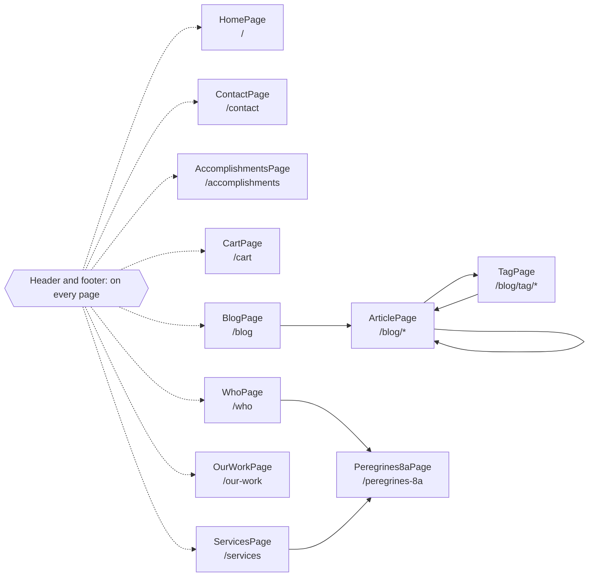

<!-- Generated by Suite Builder. EDIT RULES: do not edit this file; regenerating replaces all of it. Your own notes on the site go in ai/AI-README.md. Creator: https://github.com/ghost-in-the-kernel -->
# The site's shape

https://www.peregrineadvisors.com as the crawl saw it: each box a kind of page (its class and address), each arrow a link
between them. A solid arrow is followed by a navigation test; a dotted one is not, and why is below.
Navigation tests follow 6 of 14 transitions (coverage: transitions);
every kind of page is opened by its smoke test, 11 of 11.

## Not followed

- HomePage to CartPage: in a dropdown the crawl found nothing to open: its address is asked instead
- HomePage to WhoPage: in a dropdown the crawl found nothing to open: its address is asked instead
- HomePage to ServicesPage: in a dropdown the crawl found nothing to open: its address is asked instead
- HomePage to AccomplishmentsPage: in a dropdown the crawl found nothing to open: its address is asked instead
- HomePage to OurWorkPage: in a dropdown the crawl found nothing to open: its address is asked instead
- HomePage to BlogPage: in a dropdown the crawl found nothing to open: its address is asked instead
- HomePage to ContactPage: in a dropdown the crawl found nothing to open: its address is asked instead
- ContactPage to HomePage: in a dropdown the crawl found nothing to open: its address is asked instead
